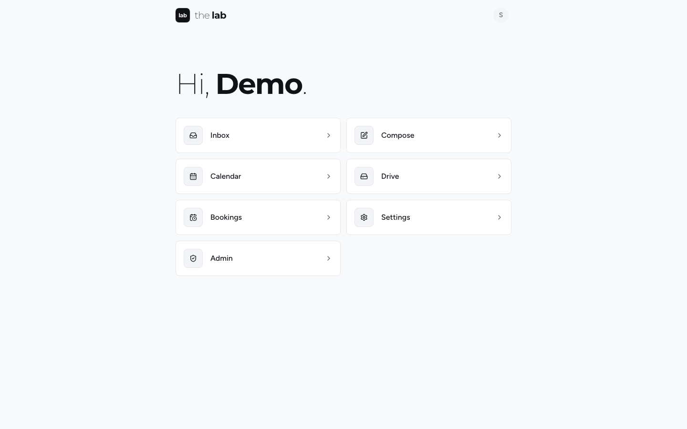
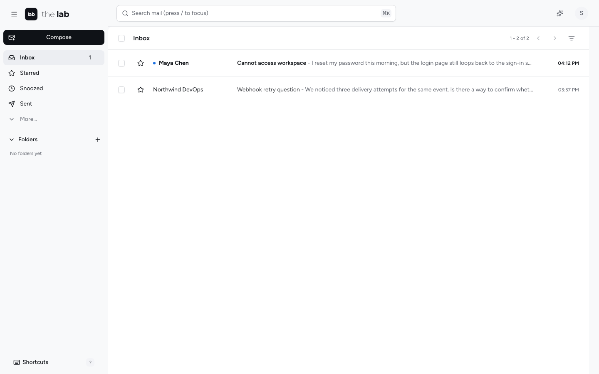
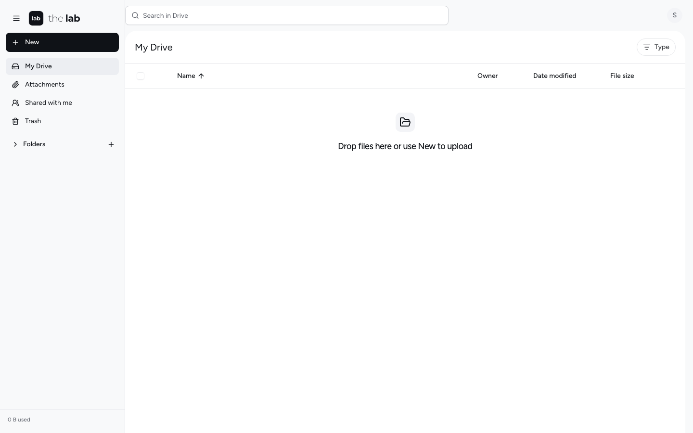

# The Lab

The Lab is my personal mail, calendar, files, booking, and agent workspace at **https://lab.jbolabs.com**. It is a maintained fork of [Mailflare](https://github.com/hieunc229/mailflare), licensed under AGPLv3.

For this installation, use the [Alchemy deployment guide](docs/jbo-deployment.md). The original Mailflare documentation below is retained for reference; do not use its standalone deploy instructions for the existing installation.

[](https://deploy.workers.cloudflare.com/?url=https://github.com/hieunc229/mailflare)

## Screenshots

| <br>Home | <br>Inbox | <br>Drive |
| --- | --- | --- |

## What you can do

- **Domains**: Connect your Cloudflare domains and choose Cloudflare, Resend, or Amazon SES for each.
- **Mailboxes**: Create personal or shared mailboxes and give other people access to them.
- **Email**: Send and receive mail with attachments, rich text, signatures, and automatic replies.
- **Calendar**: Schedule repeating events with time zones and attendees, who receive email invitations.
- **Booking pages**: Share a public link so anyone can book a free time on your calendar.
- **Organization**: Keep your inbox tidy with search, folders, stars, snooze, archive, spam, and trash.
- **Routing rules**: Store, forward, reject, or sort incoming mail automatically.
- **Notifications**: Get live inbox updates and alerts when new mail arrives.
- **Import, export, contacts**: Move mail in and out, manage contacts, and block unwanted senders.
- **Admin**: Manage users, permissions, API keys, webhooks, audit logs, and backups.
- **AI assistant**: Search your mail, draft replies, and manage calendar events with AI.
- **MCP access**: Connect AI clients over MCP, with separate permissions for each key.
- **Languages**: Use the interface in 34 languages: English, Português (Brasil), Português (Portugal), Español, Français, Deutsch, Italiano, Nederlands, Polski, Українська, Русский, Türkçe, 中文（简体）, 日本語, 한국어, Bahasa Indonesia, Bahasa Melayu, Tiếng Việt, ไทย, हिन्दी, বাংলা, मराठी, తెలుగు, தமிழ், ગુજરાતી, ಕನ್ನಡ, മലയാളം, ਪੰਜਾਬੀ, සිංහල, Kiswahili, Hausa, plus العربية, اردو and فارسی (right-to-left).

## How it works

Mailflare runs in your Cloudflare account. By default, Cloudflare Email Routing delivers incoming mail to the app, and Cloudflare's email service sends outgoing mail. Each domain can also receive or send through Resend or Amazon SES. Cloudflare still manages the DNS.

Your mail stays in your own D1 database, and attachments stay in your own R2, Backblaze B2 or AWS S3 bucket, whichever provider you use. See [Sending and receiving providers](docs/providers.md).

## Cost

**You can set up Mailflare, receive mail, and send mail for free.** Receiving with Cloudflare Email Routing is free. For sending, use the free tier of Resend or Amazon SES. Cloudflare's own email sending needs a paid Worker plan.

| Send with | Free tier | After that |
| --- | --- | --- |
| **Resend** | 3,000 emails a month (100 a day), 3 domains | From $20/month for 50,000 emails |
| **Amazon SES** | $200 AWS credit for new accounts (about 2 million emails). The free plan lasts 6 months and credits expire after 12. | $0.10 per 1,000 emails |
| **Cloudflare Email Sending** | None | Needs a [Paid Worker](https://developers.cloudflare.com/workers/platform/pricing/) plan ($5/month) |

Receiving costs:

- Cloudflare Email Routing: free.
- Resend: included in every plan.
- Amazon SES: $0.10 per 1,000 messages, plus small S3 and SNS charges.

New SES accounts start in a sandbox that only delivers to verified addresses. Request production access in the AWS console to lift this.

You choose the provider per domain and can switch anytime (see [Sending and receiving providers](docs/providers.md)). Prices change, so check [Resend](https://resend.com/pricing), [Amazon SES](https://aws.amazon.com/ses/pricing/), and [Cloudflare](https://developers.cloudflare.com/workers/platform/pricing/) first.

## Deploy

Lab deploys to Cloudflare with [Alchemy](https://alchemy.run). `alchemy.run.ts` declares the Worker, D1, R2, queues, the Durable Object and, for `prod`, the mail domains; there is no Wrangler config.

```bash
npm install
npx alchemy profile edit           # once: connect your Cloudflare account
npm run deploy                     # your own stage, live_<user>_<worktree>
```

Each deploy builds the app and applies pending migrations. Optional settings (Turnstile, AI provider, APNs, Resend/SES, B2/S3) are read from `.env`; see `.env.example`. Then:

1. **Finish setup.** Open the deployed URL and follow `/setup` to create your admin account.
2. **Connect a domain.** Add a domain and choose which service receives its mail. With a `CF_TOKEN`, Lab sets up Email Routing itself; without one, the domain page lists the DNS records to add by hand. Then create your first mailbox.

The `prod` stage (lab.jbolabs.com) is deployed by CI; see [docs/jbo-deployment.md](docs/jbo-deployment.md) and the [deployment guide](docs/deployment.md).

### Self-host with Docker

Mailflare also runs as one container on any server. It uses SQLite and local files instead of D1 and R2 (Backblaze B2 can replace the local files).

- **Inbound mail**: a built-in SMTP listener, or a small Cloudflare relay Worker if you want to keep MX on Cloudflare.
- **Outbound mail**: any SMTP relay, Cloudflare Email Sending, Resend, or Amazon SES.

```bash
cp .env.docker.example .env.docker
docker compose up -d --build
```

See [docs/self-hosting.md](docs/self-hosting.md).

## Local development

```bash
npm install
npm run dev
```

Alchemy runs the Worker and every binding locally (D1, R2, queues, the Durable Object, email and cron handlers) and applies the migrations, then serves [http://localhost:3000](http://localhost:3000) (set `PORT` to change it; each worktree gets its own stage). Optional settings go in `.env`. To load sample data, run `npm run db:seed` while the dev server is running.

- `npm run typecheck`, `npm run lint`, `npm test`: the checks CI runs.
- `npm run dev:destroy`: remove this worktree's dev stage.

The Node/Docker runtime uses the same TanStack Start HTTP handler with `build:node`, `start:node`, and `dev:node`.

## Languages

Everyone can switch language from the homepage or sign-in page, and signed-in users can set it under **Settings → Account → General**, next to their time zone. The choice is kept in a cookie, so server-rendered pages use it too.

To add a language, create `public/locales/<code>.json` with the same keys as `src/lib/i18n/en.json`, then register it in `src/lib/i18n/locales.ts` with its native name (add `dir: "rtl"` for right-to-left scripts). The selector, validation, and cookie handling pick it up from that registry. Missing keys fall back to English. English ships in the main bundle; other catalogs are static assets loaded on demand, outside the Worker size limit.

## Documentation

- [Deployment and configuration](docs/deployment.md)
- [Sending and receiving providers (Cloudflare, Resend, Amazon SES)](docs/providers.md)
- [API and integrations](docs/api.md), including the [calendar and booking APIs](docs/api.md#calendar-and-booking)
- [Email assistant and MCP](docs/email-assistant-and-mcp.md)
- [Troubleshooting](docs/troubleshooting.md)

## License

See [LICENSE](LICENSE).
